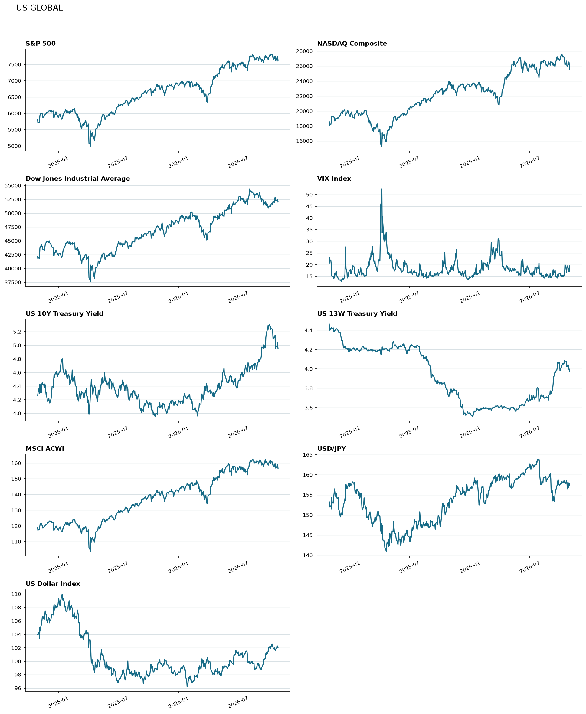
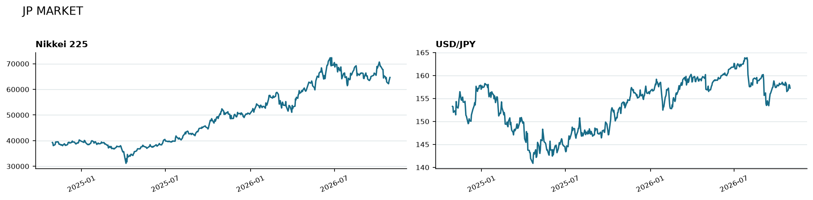
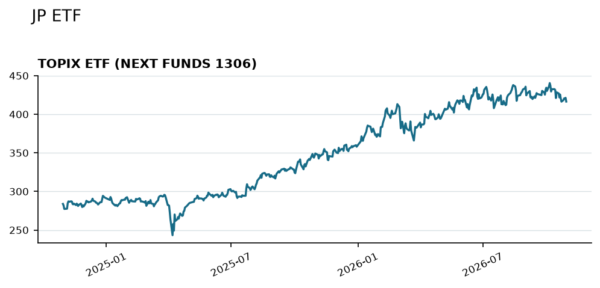
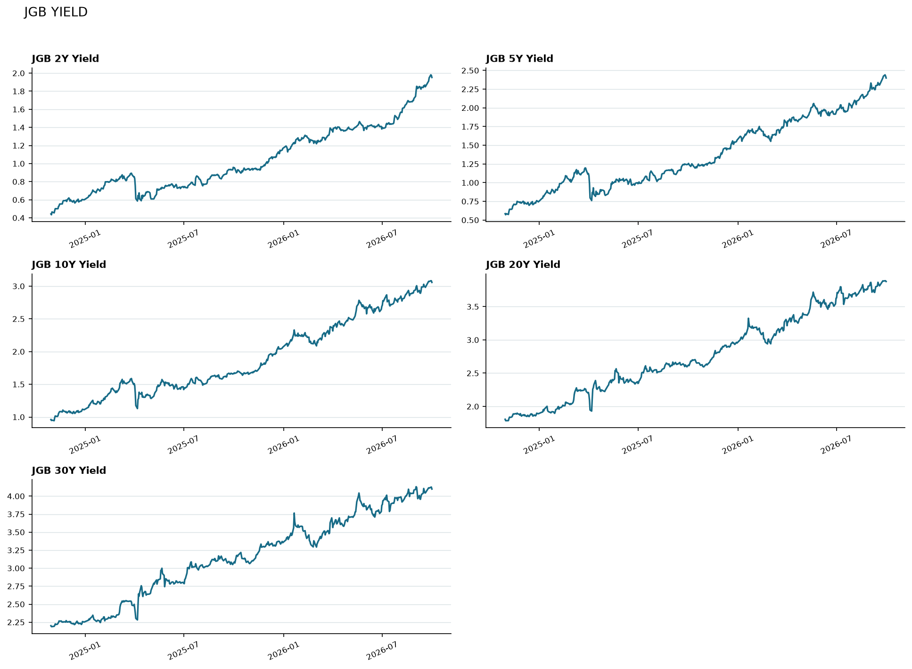

# macro-yield-tracker
財務省の国債利回り曲線や日米の金利、全世界株式などのマクロ指標を観測します。

## 実行

```bash
python -m pip install -r requirements.txt
python -m src.main
```

実行すると `output/market_dashboard.xlsx` と `output/charts/` を生成し、このファイル内の市場ダッシュボードを更新します。GitHub Actionsの `Update market dashboard` ワークフローが、平日18:00（日本時間）に自動更新します。手動実行はGitHubリポジトリの「Actions」から同ワークフローを開き、「Run workflow」を選択してください。

初回実行前に、リポジトリの「Settings」→「Actions」→「General」→「Workflow permissions」で、`GITHUB_TOKEN` の書き込みを許可してください。ワークフローはREADMEと `output/` を自動コミットします。

### Gemini日次レポートの設定

Google AI Studioで発行したキーを、リポジトリの「Settings」→「Secrets and variables」→「Actions」→「New repository secret」で `GEMINI_API_KEY` として登録してください。キーはソースやREADMEに書かず、GitHub Actionsのシークレットで管理します。キーが未設定の場合も市場データの更新は続行し、AIレポートの生成だけをスキップします。ローカル実行では、環境変数 `GEMINI_API_KEY` を設定してから `python -m src.main` を実行してください。ワークフロー実行1回につきGemini APIを1回呼び出すため、Google AI Studio側の利用枠・料金が適用されます。

関連ニュースを自動で取り込みたい場合は、`NEWS_API_KEY` を同じくGitHub Secretsに追加してください。未設定時でも、RSSのフォールバックで国内・海外の見出しを拾おうと試みます。キーがない場合は、ニュースを使わずに市場データだけで解説します。

### データ品質とレポートの読み方

日次レポートでは価格の単位を明示し、TOPIX連動ETFをTOPIX指数の代替値として扱いません。NEXT FUNDS TOPIX連動型上場投信で前回観測から30%を超える変動があれば品質警告を出します。前後の観測が7日以内にあり、値が反転して前の水準の15%以内に戻る単発の変動は、誤データの可能性が高い観測として履歴・チャート・レポートから除外します。生成レポートの市場数値は入力データと照合し、一致しない場合は公開を見送ります。ニュースは公開日を取得できた記事見出しに限定し、日付不明の記事は掲載しません。日本国債利回りは財務省CSVの最新観測日を表示し、株価と日付が離れている場合は同日の連動・因果を説明しません。米ドル建て資産は、同じ日付のUSD/JPYを使った円換算参考リターンも示します（配当・費用・税金を含みません）。

<!-- MARKET-DASHBOARD:START -->
## 市場ダッシュボード

最終更新: 2026年10月31日 00:30 (JST)

| 指標 | シンボル | 最新値 | 前回値 | 前回観測比 | 種別 | 単位 | 注記 |
|---|---|---:|---:|---:|---|---|---|
| MSCI ACWI | `ACWI` | 156.56 (2026-10-30) | 158.81 | -2.25 (-1.42%) | 価格 | USD/口 | 前回観測から1日 / 変化: -2.25 (-1.42%) |
| NASDAQ総合 | `^IXIC` | 25,564.36 (2026-10-30) | 26,184.72 | -620.4 (-2.37%) | 価格 | 指数ポイント | 前回観測から1日 / 変化: -620.4 (-2.37%) |
| NYダウ | `^DJI` | 52,029.93 (2026-10-30) | 52,342.56 | -312.6 (-0.60%) | 価格 | 指数ポイント | 前回観測から1日 / 変化: -312.6 (-0.60%) |
| S&P 500 | `^GSPC` | 7,607.57 (2026-10-30) | 7,720.39 | -112.8 (-1.46%) | 価格 | 指数ポイント | 前回観測から1日 / 変化: -112.8 (-1.46%) |
| TOPIX | `^TPX` | データなし | — | — | 価格 | 指数ポイント | この更新ではデータを取得できませんでした |
| TOPIX連動ETF (NEXT FUNDS TOPIX連動型上場投信) | `1306.T` | 416.40 (2026-10-30) | 421.30 | -4.9 (-1.16%) | 価格 | JPY/口 | 前回観測から1日 / 変化: -4.9 (-1.16%) |
| VIX指数 | `^VIX` | 19.4600 (2026-10-30) | 17.2000 | +2.26 (+13.14%) | 価格 | 指数ポイント | 前回観測から1日 / 変化: +2.26 (+13.14%) |
| ドルインデックス | `DX-Y.NYB` | 101.99 (2026-10-30) | 102.04 | -0.049 (-0.05%) | 価格 | 指数ポイント | 前回観測から1日 / 変化: -0.049 (-0.05%) |
| ドル円 (USD/JPY) | `USDJPY=X` | 157.23 (2026-10-30) | 157.83 | -0.602 (-0.38%) | 価格 | JPY/USD | 前回観測から1日 / 変化: -0.602 (-0.38%) |
| 日本国債10年利回り | `MOF:JGB:10Y` | 3.057% (2026-09-30) | 3.082% | -2.5 bp | 利回り | % | 前回観測から1日 / 変化: -2.5 bp |
| 日本国債20年利回り | `MOF:JGB:20Y` | 3.877% (2026-09-30) | 3.887% | -1.0 bp | 利回り | % | 前回観測から1日 / 変化: -1.0 bp |
| 日本国債2年利回り | `MOF:JGB:2Y` | 1.952% (2026-09-30) | 1.976% | -2.4 bp | 利回り | % | 前回観測から1日 / 変化: -2.4 bp |
| 日本国債30年利回り | `MOF:JGB:30Y` | 4.098% (2026-09-30) | 4.126% | -2.8 bp | 利回り | % | 前回観測から1日 / 変化: -2.8 bp |
| 日本国債5年利回り | `MOF:JGB:5Y` | 2.399% (2026-09-30) | 2.425% | -2.6 bp | 利回り | % | 前回観測から1日 / 変化: -2.6 bp |
| 日経平均株価 | `^N225` | 64,659.47 (2026-10-29) | 63,954.19 | +705.3 (+1.10%) | 価格 | 指数ポイント | 前回観測から1日 / 変化: +705.3 (+1.10%) |
| 米10年債利回り | `^TNX` | 4.952% (2026-10-30) | 4.989% | -3.7 bp | 利回り | % | 前回観測から1日 / 変化: -3.7 bp |
| 米13週国債利回り | `^IRX` | 3.978% (2026-10-30) | 3.998% | -2.0 bp | 利回り | % | 前回観測から1日 / 変化: -2.0 bp |

### 推移

#### 米国・グローバル市場



#### 日本市場



#### 日本市場・ETF



#### 日本国債利回り



### データソース

- 市場価格・指数・為替・米国債利回り: Yahoo Finance（`yfinance`）
- 日本国債の利回り曲線: 財務省「国債金利情報」CSV（2・5・10・20・30年）
- 利回りの変化幅はbp（1bp = 0.01%）で表示しています。
- TOPIX連動ETFは指数そのものではなく、円建てETFの市場価格です。
<!-- MARKET-DASHBOARD:END -->

<!-- AI-DAILY-REPORT:START -->
## AIマーケット日次レポート

生成日時: 2026年10月31日 00:30 (JST)

### 今日の市場をひとことで
日本市場では、TOPIX連動ETF（1306.T）が前営業日（2026年10月29日）比で-1.163%の416.399994 JPY/口となり、日経平均株価（^N225）も前営業日（2026年10月28日）比で+1.103%の64659.46875 指数ポイントと、指標によって異なる動きを見せました。一方、米国株はS&P 500が前営業日（2026年10月29日）比で-1.461%の7607.569824 指数ポイント、NYダウも-0.597%と下落し、ドル円（USD/JPY）は前営業日（2026年10月29日）比で-0.381%の157.231003 JPY/USDと円高方向に動きました。チャート全期間（2024年10月30日から2026年10月30日）では、TOPIX連動ETFが283.850006 JPY/口から416.399994 JPY/口へ46.697%上昇しており、当日の変化は長期傾向とは逆方向でした。公開日付きのニュース見出しはいくつか確認できましたが、見出しだけでは市場との明確な因果関係を判断できません。総じて、米国株が下落し、VIX指数が上昇するなど、リスク回避の動きが見られる局面です。


### 主な指標の動き
2026年10月30日の市場では、TOPIX連動ETF（NEXT FUNDS TOPIX連動型上場投信、1306.T）が416.399994 JPY/口で取引を終え、前営業日（2026年10月29日）比で-4.899994 JPY/口（-1.163%）の下落となりました。TOPIX指数自体のデータは欠測です。TOPIX連動ETFの騰落率はETF自体の価格変化であり、指数の騰落率と一致するとは限りません。日経平均株価（^N225）は2026年10月29日時点で64659.46875 指数ポイントとなり、前営業日（2026年10月28日）比で+705.277344 指数ポイント（+1.103%）の上昇でした。

米国株では、S&P 500（^GSPC）が7607.569824 指数ポイントで、前営業日（2026年10月29日）比で-112.820312 指数ポイント（-1.461%）の下落。NYダウ（^DJI）は52029.929688 指数ポイントで、前営業日（2026年10月29日）比で-312.628906 指数ポイント（-0.597%）の下落。NASDAQ総合（^IXIC）は25564.357422 指数ポイントで、前営業日（2026年10月29日）比で-620.363281 指数ポイント（-2.369%）の大幅な下落となりました。

為替市場では、ドル円（USD/JPY）が157.231003 JPY/USDとなり、前営業日（2026年10月29日）比で-0.60199 JPY/USD（-0.381%）と円高ドル安に推移しました。ドルインデックス（DX-Y.NYB）も101.990997 指数ポイントで、前営業日（2026年10月29日）比で-0.049004 指数ポイント（-0.048%）とわずかに下落しました。

金利市場では、米10年債利回り（^TNX）が4.952%で、前回観測日（2026年10月29日）比で-3.7ベーシスポイント（bp）と低下しました。ベーシスポイント（bp）とは、金利の変動幅を示す単位で、1bpは0.01%に相当します。米13週国債利回り（^IRX）も3.978%で、前回観測日（2026年10月29日）比で-2.0bpの低下でした。一方、日本国債10年利回り（MOF:JGB:10Y）は2026年9月30日時点で3.057%であり、前回観測日（2026年9月29日）比で-2.5bpの低下でした。日本国債利回りは最新の株価データよりも観測日が遅れています。

市場の不確実性を示すVIX指数（^VIX）は19.459999 指数ポイントとなり、前営業日（2026年10月29日）比で+2.259998 指数ポイント（+13.14%）と大きく上昇しました。これは市場の警戒感が高まっていることを示唆しています。


### 国内外のニュースと市場の反応
2026-10-30公開の見出しとして、読売新聞は「トランプ氏が遊説中止、健康問題かと問われ「君は病んでいる」「お前こそ体形を整えろ」…記者団に激高 - 読売新聞」を掲載しています。2026-10-30公開の見出しとして、朝日新聞は「都立六本木高校で生徒が刃物で刺され搬送 同学年の生徒を現行犯逮捕 [東京都] - 朝日新聞」を掲載しています。2026-10-30公開の見出しとして、Yahoo!ニュースは「学校法人同志社の会見5時間で終了 辺野古転覆事故、初出席の八田理事長らへの批判相次ぐ 辺野古転覆事故、同志社会見（10）（産経新聞） - Yahoo!ニュース」を掲載しています。ここでは公開日と見出しを確認できた情報だけを記載しています。記事本文に基づく詳細や、市場の値動きとの直接的な因果関係は断定しません。

### オルカン・S&P 500を保有する人向けの見方
「オルカン」と呼ばれるMSCI ACWI（ACWI）とS&P 500（^GSPC）は、世界経済の成長を取り込むための長期分散投資の代表的な指標です。

2024年10月30日から2026年10月30日までの期間で、MSCI ACWIのUSD建て価格リターンは31.74%でした。これを為替を反映した円換算で見ると、35.141%のリターンとなり、為替変動によるプラス効果が3.401パーセンテージポイントありました。同様に、S&P 500のUSD建て価格リターンは30.857%でしたが、円換算では34.235%となり、為替変動によるプラス効果は3.378パーセンテージポイントでした。これらの円換算値は、同日終値を使用した価格リターンであり、配当、手数料、税金を含まない参考比較です。実際の投資信託の実績とは異なります。

短期的な市場の変動は避けられないものですが、オルカンやS&P 500のような広範な指数への投資は、特定の国や企業に集中するリスクを軽減し、長期的な視点での資産形成を目指すものです。日々の値動きに一喜一憂せず、自身の投資目標とリスク許容度に基づいた長期的な視点を維持することが重要です。


### チャートで見る直近の流れ
TOPIX連動ETF（1306.T）の直近の数観測では、2026年10月26日の418.399994 JPY/口から10月29日の421.299988 JPY/口まで上昇した後、10月30日には416.399994 JPY/口へと下落しました。チャート期間（2024年10月30日から2026年10月30日）全体では、283.850006 JPY/口から416.399994 JPY/口へと46.697%上昇しており、長期的な上昇トレンドの中にあります。期間高値は2026年10月06日の440.399994 JPY/口、期間安値は2025年04月07日の243.25 JPY/口であり、現在値は期間高値に近い水準に位置しています。

S&P 500（^GSPC）の直近の数観測では、2026年10月26日の7676.77002 指数ポイントから10月28日の7743.97998 指数ポイントまで上昇した後、10月30日には7607.569824 指数ポイントへと下落しました。チャート期間（2024年10月30日から2026年10月30日）全体では、5813.669922 指数ポイントから7607.569824 指数ポイントへと30.857%上昇しており、こちらも長期的な上昇トレンドです。期間高値は2026年10月06日の7818.930176 指数ポイント、期間安値は2025年04月08日の4982.77002 指数ポイントであり、現在値は期間高値に近い位置にあります。

米10年債利回り（^TNX）は、直近の数観測では2026年10月28日の5.045%から10月30日の4.952%へと低下しました。チャート期間（2024年10月30日から2026年10月30日）では、4.266%から4.952%へと68.6bp上昇しており、長期的に見れば金利は上昇傾向にあります。期間高値は2026年10月05日の5.311%、期間安値は2025年10月22日の3.953%です。

VIX指数（^VIX）は、直近の数観測では2026年10月28日の16.91 指数ポイントから10月30日の19.459999 指数ポイントへと上昇しました。チャート期間（2024年10月30日から2026年10月30日）では、20.35 指数ポイントから19.459999 指数ポイントへと-4.373%低下しており、長期的なボラティリティ（価格変動の度合い）はやや落ち着いているものの、直近では警戒感が高まっています。期間高値は2025年04月08日の52.330002 指数ポイント、期間安値は2024年12月06日の12.77 指数ポイントです。

---
**データ更新日の違いに関する注意書き:**
本レポートに記載されている市場データは、JST基準の2026年10月31日00:30時点のものです。各指標の最終観測日はJSONデータに基づいています。日経平均株価は2026年10月29日時点、TOPIX連動ETF、MSCI ACWI、ドルインデックス、ドル円、NYダウ、S&P 500、米13週国債利回り、NASDAQ総合、米10年債利回り、VIX指数は2026年10月30日時点のデータです。日本国債利回り（2年、5年、10年、20年、30年）は2026年9月30日時点のデータであり、他の指標よりも観測日が約1ヶ月遅れています。そのため、日本国債利回りの変動と最新の株価動向との直接的な因果関係を述べることはできません。

### 参照したニュース・資料
- [読売新聞（公開日: 2026-10-30）](https://news.google.com/rss/articles/CBMiYkFVX3lxTFAxRm5zX0JuMHR6aTBJdHNtbF8tak1yRGxBMFhNTVRuMkZwQWhjWm1NRE1yVThJVThIZHdLdUpHSFVFbHNSSFhaWE1zYjktRGJLN1VHZlFVMVVuQ2pkQlJFVF9B?oc=5)
- [朝日新聞（公開日: 2026-10-30）](https://news.google.com/rss/articles/CBMiZ0FVX3lxTFBXOWxMdFBjVWxkS1NyNmJOSHF0RUlaRnlVWV9jY3RlWEh1WUNWenNyeV9WS2I4M25jWW1XeXpRVERBZ0t4azd4bEljVW9lQThTdGp6LXdrTTcxb3NlYzIzck8wS3RLVGs?oc=5)
- [Yahoo!ニュース（公開日: 2026-10-30）](https://news.google.com/rss/articles/CBMif0FVX3lxTE1DWEdOR1BadGZ0c19pRy1sa29PblQ3NHp4Q1R5WHYtcElqbzEwX0dPc0JNMFZFRm1SWWQ0ZDRhMjAtTkdXTzlyRFJiQk1Vd1dmLUU1MXVTOXpwaDAySGZrOTBySnBLby1mV1VtVnZadHE5OTR6a3ljbDdJajVKUXc?oc=5)

※公開情報をもとにした一般的な解説です。特定の個人への投資助言ではありません。
<!-- AI-DAILY-REPORT:END -->
